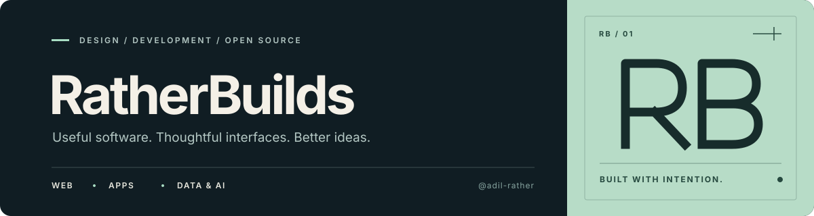

<!-- RATHERBUILDS — GITHUB PROFILE -->

  

<samp>SOFTWARE DEVELOPMENT · APPLIED AI · INTERFACE DESIGN</samp>

<h2>Thoughtful interfaces. Useful software.</h2>

Hi, I'm <strong>Adil Hassan</strong> — a Computer Science graduate
building desktop tools, exploring data and machine learning,
and creating clean web experiences.

 

### 🌐 Connect with Me

---

 

### 🧰 Tech Stack

---

**Core tools and languages**

**Frameworks and tools used in projects**

 

### 🚀 Selected Projects

---

<table>
<tr>
<td width="50%" valign="top">

<h3><a href="https://github.com/adil-rather/Sivinx-Stream">Sivinx Stream ↗</a></h3>

Windows voice dictation with push-to-talk recording and local or cloud speech-to-text options.

<code>Windows</code> <code>Speech-to-text</code> <code>AI</code>

</td>
<td width="50%" valign="top">

<h3><a href="https://github.com/adil-rather/AI-Data-Analyzer">AI Data Analyzer ↗</a></h3>

A local workspace for exploring datasets, visualizing patterns, and experimenting with machine-learning workflows.

<code>Python</code> <code>FastAPI</code> <code>React</code>

</td>
</tr>

<tr>
<td width="50%" valign="top">

<h3><a href="https://github.com/adil-rather/interactive-web-dasbord">Interactive Web Dashboard ↗</a></h3>

A responsive analytics interface with KPI cards, interactive charts, data tables, and light/dark themes.

<code>HTML</code> <code>CSS</code> <code>JavaScript</code>

</td>
<td width="50%" valign="top">

<h3><a href="https://github.com/adil-rather/Font_Styles">Font Styles Archive ↗</a></h3>

An organized collection of typefaces and typography resources for exploring styles and design choices.

<code>Typography</code> <code>Resources</code>

</td>
</tr>
</table>

 

### 📊 GitHub Analytics

---

 

### 📈 Contribution Graph

---

 

### ✦ How I Build

---

Build for real problems. Keep interfaces clear. 
Learn by building, testing, and improving.

 

  

RATHERBUILDS — BUILD WITH INTENTION.

  

<a href="https://ratherbuilds.site">Website</a>
&nbsp;·&nbsp;
<a href="https://github.com/adil-rather?tab=repositories">Repositories</a>
&nbsp;·&nbsp;
<a href="https://www.linkedin.com/in/adilhassan-rb/">LinkedIn</a>

